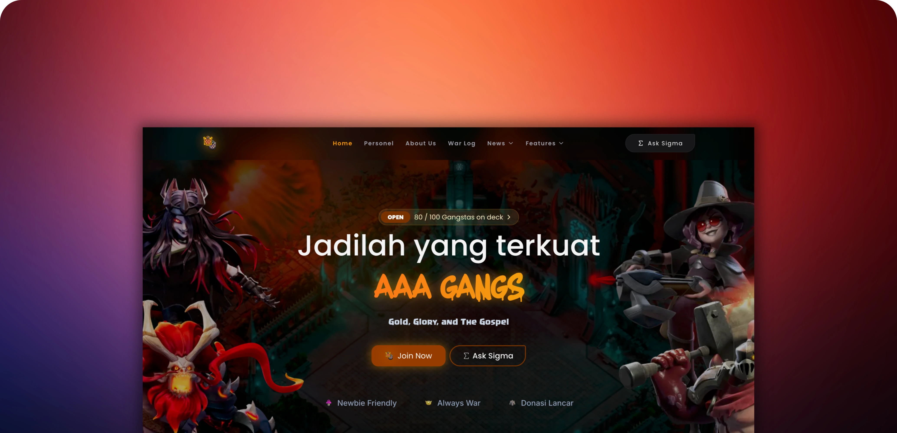

[](https://www.3agang.pro/)


[](https://www.3agang.pro/)
<table border="0">
  <tr>
    <td align="left" valign="middle">
      <br>
      <br>
      
    </td>
    <td align="left" valign="middle">
      <br>
      <br>
      
    </td>
    <td align="left" valign="middle">
      <br>
      <br>
      
    </td>
    <td align="right" valign="top">
      
    </td>
  </tr>
</table>

The Next.js website for the AAA GANG Clash of Clans community. It brings
together clan and player information, war tools, base layouts, Basehunt visual
search, news, and the Sigma chat experience.

> This is an unofficial fan project and is not endorsed by Supercell. Please
> review the [Supercell Fan Content Policy](https://supercell.com/en/fan-content-policy/).

## Features

- **Clan dashboard** — clan overview, member highlights, and war information.
- **Member and player search** — browse clan members and look up player tags.
- **War tools** — war log, live war status, and CWL status/report pages.
- **Base layouts** — browse, filter, and view Clash of Clans base layouts.
- **Basehunt** — upload a base screenshot and search for up to five visually
  similar active layouts.
- **Sigma** — a chat interface backed by configurable OpenAI-compatible model
  services and Clash of Clans context.
- **News and esports** — browse news and individual articles.
- **Admin dashboard** — manage layout content behind admin authentication.
- **Additional tools and information** — clan search, maps, coaching, FAQ,
  contact, privacy, terms, and DMCA pages.

## Tech stack

- Next.js 16 App Router, React 19, and TypeScript
- Tailwind CSS 4
- Turso/libSQL for layout and related site data
- Hugging Face Spaces FastAPI service for Basehunt image matching
- OpenAI-compatible chat APIs and Google Generative AI SDK
- Leaflet / React Leaflet for map features

## Requirements

- Node.js 22 recommended (the repository Dockerfile uses Node 22)
- npm
- Runtime environment variables for the features you enable

## Run locally

```bash
npm ci
npm run dev
```

Open <http://localhost:3000>.

Useful commands:

```bash
npx tsc --noEmit
npm run build
npm start
```

`npm start` runs the production build, so run `npm run build` first. There is
currently no dedicated test or lint script in `package.json`.

## Environment configuration

Create `.env.local` in the repository root for local development. It is ignored
by Git. Set production values in your hosting provider's environment/secret
manager. Never commit real credentials or expose server secrets through
`NEXT_PUBLIC_` variables.

### Core site features

| Variable | Used for |
| --- | --- |
| `COC_API_KEY` | Clash of Clans API access through the configured proxy. |
| `CLAN_TAG` | Main clan tag used by clan and war pages. |
| `ALIANSI_CLAN_TAG` | Optional secondary clan tag. |
| `TURSO_DATABASE_URL` | Turso database connection. |
| `TURSO_AUTH_TOKEN` | Turso authentication token. |
| `JWT_SECRET` | Signing admin session tokens. |
| `ADMIN_USERNAME` | Admin login username. |
| `ADMIN_PASSWORD` | Admin login password. |

### Feature-specific variables

| Variable | Used for |
| --- | --- |
| `BASEHUNT_API_KEY` | Server-to-server authentication with the Basehunt FastAPI service. Required for Basehunt. |
| `BASEHUNT_API_URL` | Optional Basehunt API base URL. Defaults to the configured Hugging Face Space URL in `src/app/api/basehunt/route.ts`. |
| `BASIC_BASE_URL` | OpenAI-compatible endpoint used by the default Sigma chat backend. |
| `BASIC_API_KEY` | API key for the default Sigma chat backend. |
| `SELF_HOSTED_BASE_URL` | Optional current self-hosted Sigma backend URL. |
| `SELF_HOSTED_API_KEY` | API key for the current self-hosted Sigma backend. |
| `SELF_HOSTED_OLD_BASE_URL` | Optional legacy self-hosted Sigma backend URL. |
| `SELF_HOSTED_OLD_API_KEY` | API key for the legacy self-hosted Sigma backend. |
| `NEXT_PUBLIC_GA_ID` | Optional Google Analytics measurement ID. |
| `NEXT_PUBLIC_ADSENSE_ID` | Optional Google AdSense publisher ID. |
| `CARTO_BASEMAP_API_KEY` | Optional Carto basemap key fallback referenced by map components. |
| `NEXT_PUBLIC_CARTO_BASEMAP_API_KEY` | Optional Carto basemap key used by client map components. |

Configure only the variables needed by the features being run. Basehunt
requires the Basehunt API key and Turso credentials on the Next.js server; the
browser must not receive these values. For the Basehunt flow and response
contract, see [`src/app/basehunt/implement.md`](src/app/basehunt/implement.md).

## Routes

### Public pages

| Route | Purpose |
| --- | --- |
| `/` | Clan homepage and overview |
| `/basehunt` | Screenshot-based base search |
| `/layout` | Base layout collection |
| `/layout/[id]` | Layout details |
| `/members` | Clan members |
| `/members/[tag]` | Player profile |
| `/search` | Player tag search |
| `/clansearch` | Clan tag search |
| `/clansearch/[searched]` | Clan search result |
| `/livewarstatus` | Live war overview |
| `/livewarstatus/[clanTag]` | Live war for a clan |
| `/livecwlstatus` | CWL overview |
| `/livecwlstatus/[clanTag]` | CWL status for a clan |
| `/livecwlstatus/[clanTag]/war/[warTag]` | CWL war report |
| `/warlog` | War history |
| `/sigma` | Sigma chat |
| `/news` | News and esports |
| `/news/article/[id]` | News article |
| `/news/esports/[id]` | Esports article |
| `/coaching` | Coaching page |
| `/deffendanalysis` | Defense analysis page |
| `/faq` | Frequently asked questions |
| `/tentang` | About |
| `/contact` | Contact |
| `/privacy` | Privacy policy |
| `/termsofservice` | Terms of service |
| `/dmca` | DMCA information |

### API routes

| Endpoint | Method | Purpose |
| --- | --- | --- |
| `/api/basehunt` | `POST` | Validates an image, calls the Basehunt API, then returns active layout metadata from Turso. |
| `/api/chat` | `POST` | Streams Sigma chat responses. |
| `/api/clan` | `GET` | Returns clan data for client pages. |
| `/api/player` | `GET` | Looks up player data. |
| `/api/comments` | `GET`, `POST`, `PUT` | Reads and manages layout comments. |
| `/api/proxy` | `POST` | Admin-authenticated database proxy used by the application. |

Admin pages are grouped under `src/app/admin/`. Route groups such as `(auth)`
and `(protected)` organize layouts without adding those names to the URL.

| Admin route | Purpose |
| --- | --- |
| `/admin/login` | Admin sign-in |
| `/admin/home` | Protected admin landing page |
| `/admin/dashboard` | Layout management |
| `/admin/dashboard/new` | Create a layout |
| `/admin/dashboard/edit/[id]` | Edit a layout |
| `/admin/settings` | Admin settings |

## Repository structure

```text
.
├── public/                  # Images, videos, fonts, and other static assets
├── scripts/                 # Supporting and legacy Python scripts
├── src/
│   ├── app/                 # App Router pages, API routes, and server actions
│   │   ├── admin/           # Admin authentication and dashboard
│   │   ├── api/             # Route handlers
│   │   ├── basehunt/        # Basehunt page and implementation notes
│   │   ├── layout/          # Layout collection, details, and actions
│   │   ├── livecwlstatus/
│   │   ├── livewarstatus/
│   │   ├── members/
│   │   ├── news/
│   │   └── ...              # Other public routes
│   ├── components/          # Shared and feature-specific React components
│   │   └── ui/              # Shared UI primitives
│   ├── constants/           # Shared constants
│   ├── context/             # Clash and layout context data
│   ├── lib/                 # API clients and shared utilities
│   └── types/               # Shared TypeScript types
├── Dockerfile               # Node 22 multi-stage standalone deployment
├── next.config.ts
├── package.json
└── README.md
```

## Data and integrations

- Layouts, comments, and related metadata are read from Turso using
  `@libsql/client`.
- Clan and player data use the Clash of Clans API through the configured
  RoyaleAPI proxy.
- Sigma uses configured OpenAI-compatible backends. Keep provider keys on the
  server.
- Basehunt sends the uploaded image from the Next.js route handler to the
  FastAPI service. The service performs matching; Next.js then looks up active
  card metadata from Turso. API and database credentials are server-side.
- The sitemap is generated by `src/app/sitemap.ts`.

## Deployment

### Vercel or another Next.js host

1. Connect the repository to the host.
2. Configure the server-side environment variables required by the enabled
   features.
3. Deploy using the standard Next.js build command, `npm run build`.
4. Verify the public pages and API routes, including one permitted Basehunt
   search.

### Docker

Use the repository's root `Dockerfile`; it builds a standalone Next.js
application using Node 22. Configure production secrets through the runtime
environment of the container host, not by committing them to the image or
repository.

## Notes

- Hugging Face Spaces on free hardware can sleep after inactivity; a first
  Basehunt request after a sleep period may take longer.
- `/api/basehunt` is a public endpoint. The FastAPI key protects the
  server-to-server request, not access to the Next.js route itself. Add
  platform-level rate limiting if traffic or abuse requires it.
- Uploaded screenshots are forwarded for matching and are not persisted by
  this Next.js route. Hosting platforms may still have their own request
  buffering and logging behavior.
- The Basehunt similarity score is for ranking matches and should not be
  interpreted as a probability.
- Do not rely on this README as a database migration guide; the application
  expects the relevant Turso tables and schema to exist already.

## License

This project is licensed under the MIT License. See [`LICENSE`](LICENSE).
